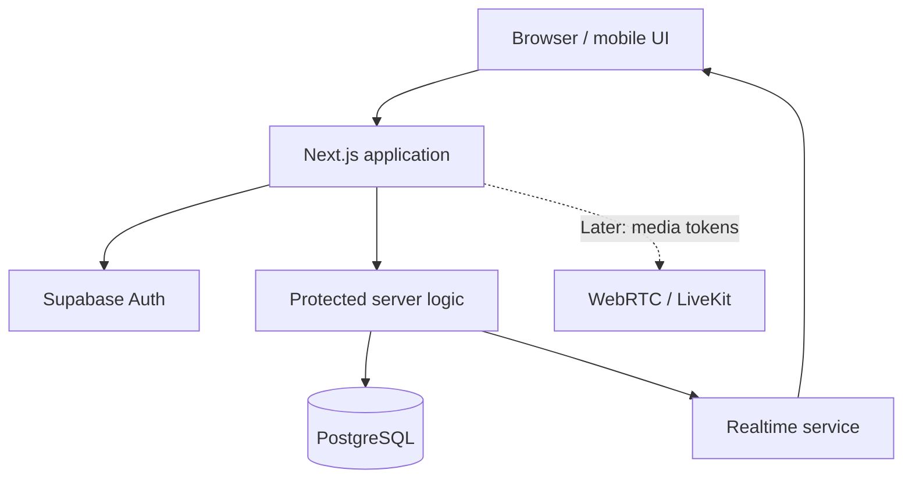
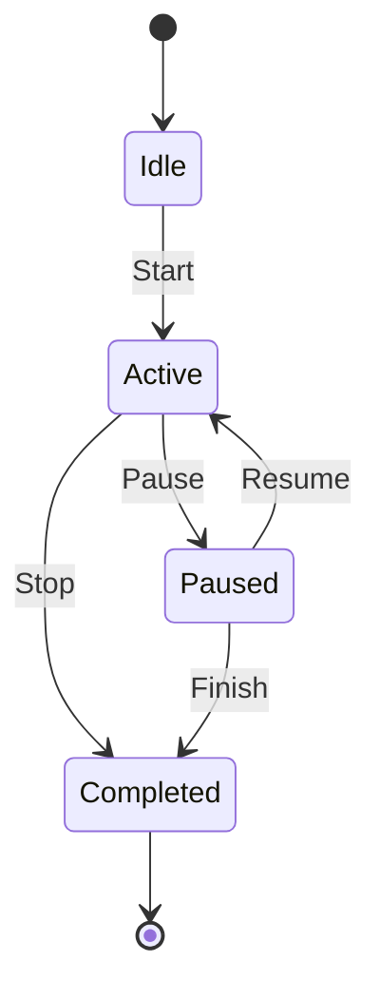

# Focie — Product Requirements & AI Build Specification

> **Purpose:** This document is the single source of truth for building Focusie with AI coding tools.
>
> **Product summary:** Focusie is a cozy, kawaii, pastel study-with-friends web app. Users track focused study sessions, see friends' activity update live, compete on fair leaderboards using configurable personal study days, send virtual gifts, and study together in private rooms.

---

## How to use this document with AI coding tools

1. Put this file in the root of your repository as `FOCUSIE_SPEC.md`.
2. Ask your AI coding tool to **read the entire file before making changes**.
3. Build one phase at a time. Do not ask the AI to implement the entire product in one giant prompt.
4. After each phase, run the listed checks, inspect the changes, and commit working code.
5. If the AI wants to change the architecture or a requirement, ask it to explain why before accepting.
6. Keep this document updated when you make product decisions.

### Suggested initial AI prompt

> Read `FOCUSIE_SPEC.md` completely. First inspect the existing repository and report its current structure, stack, completed work, and gaps. Do not modify any files yet. Then propose an implementation plan for **Phase 0 only**, listing files to create/change, database migrations, acceptance criteria, and tests. Preserve the requirements in the spec. Ask before making architectural changes. Do not implement future phases until requested.

---

# 1. Product vision

## 1.1 Mission

Make focused study feel more social, rewarding, and sustainable by giving friends a shared place to study, encourage one another, and celebrate progress.

## 1.2 Product principles

- [ ] **Cute, not childish:** warm, polished, friendly visual design.
- [ ] **Progress over pressure:** encourage consistency without shaming users.
- [ ] **Fair competition:** define the measurement window clearly.
- [ ] **Server-authoritative tracking:** never trust a browser-submitted duration or coin balance.
- [ ] **Privacy by default:** study status, rooms, and messages are visible only to authorized people.
- [ ] **Mobile-first usability:** core timer actions must be easy on a phone.
- [ ] **Ship the core loop first:** reliability before decorative complexity.

## 1.3 Target users

- Students who want accountability while studying.
- Friends who study at different hours but want to encourage one another.
- Small groups that want a cozy virtual study room.

## 1.4 Core loop

1. User starts a focus session.
2. Friends see the active status and elapsed timer update live.
3. User pauses for a break or ends the session.
4. Focusie calculates valid focused time.
5. The dashboard and leaderboard update.
6. User earns eligible rewards and can send a gift.
7. The mascot reacts to milestones and progress.
8. User returns for another session or a shared challenge.

---

# 2. Scope and release strategy

## 2.1 MVP — build these first

- [ ] Authentication and profile
- [ ] Friend search, requests, acceptance, removal, and blocking
- [ ] Start, pause, resume, and end a study session
- [ ] Persisted sessions that survive refreshes and reconnects
- [ ] Live friend study status and elapsed timer
- [ ] Personal 24-hour study-day settings
- [ ] Correct handling of sessions that cross a study-day boundary
- [ ] Daily leaderboard with a clearly displayed measurement window
- [ ] Earnable virtual coins and basic gifts
- [ ] Private study rooms with member list and text chat
- [ ] Responsive dashboard and accessible core controls
- [ ] Privacy and authorization rules
- [ ] Automated tests for critical time and permission logic

## 2.2 Later releases — do not block the MVP

- [ ] Voice/video rooms using a WebRTC service
- [ ] Advanced mascot evolution and collectible outfits
- [ ] Custom room themes and ambient soundscapes
- [ ] Group quests and weekly challenges
- [ ] More gift types, reactions, and room activities
- [ ] Push notifications, if users opt in
- [ ] Optional calendar integrations
- [ ] Advanced analytics and moderation tools

## 2.3 Explicitly out of scope for the MVP

- [ ] Real-money purchases
- [ ] AI-based claims that the app can detect whether someone is truly paying attention
- [ ] Publicly exposing a user's activity by default
- [ ] A full Discord replacement
- [ ] Complex social feeds or public follower counts

---

# 3. Recommended technology stack

Use this stack unless repository constraints justify a documented alternative.

- **Frontend:** Next.js, React, TypeScript
- **Styling:** Tailwind CSS with shared design tokens
- **Backend/data:** Supabase PostgreSQL
- **Authentication:** Supabase Auth
- **Live updates:** Supabase Realtime/private channels
- **Server logic:** protected server routes and/or Supabase database functions
- **Deployment:** Vercel for the Next.js app; Supabase for data and realtime
- **Validation:** Zod or an equivalent schema validator
- **Testing:** Vitest for unit tests; Playwright for end-to-end tests
- **Optional voice/video later:** LiveKit or another suitable WebRTC service
- **Optional animation:** a React animation library, used sparingly

### Stack rules

- [ ] Never expose service-role keys or other secrets to the browser.
- [ ] Enable Row Level Security (RLS) on all user-owned/private tables.
- [ ] Keep database migrations in version control.
- [ ] Use separate development and production environments.
- [ ] Do not add a library without a concrete need.
- [ ] Verify current provider pricing, quotas, and limits before launch.

---

# 4. Visual identity and design system

## 4.1 Brand

- **Product name:** Focusie (working name; verify domain, social handle, and trademark availability before public launch)
- **Tagline:** “Focus feels better together.”
- **Style:** kawaii, pastel, cozy, soft 3D illustrations, rounded UI, generous whitespace
- **Mascot:** an original small rounded creature called **Fumi**, with expressive eyes, soft blush, and a distinctive star detail
- **Tone:** encouraging, warm, playful, never guilt-inducing

## 4.2 Suggested palette

| Token | Hex | Use |
|---|---|---|
| Blush Pink | `#F7DCE7` | Primary accent and progress |
| Lavender | `#E7E0FA` | Secondary panels |
| Butter Yellow | `#F9EDC7` | Rewards and achievements |
| Mint | `#DDEFE2` | Success and completion |
| Warm Cream | `#FFFBF5` | Main background |
| Dark Plum | `#514453` | Main text |
| Muted Mauve | `#806F7C` | Secondary text |

## 4.3 Typography and UI

- [ ] Use a rounded display font such as Nunito for headings.
- [ ] Use a highly readable font such as Inter for body text and numbers.
- [ ] Keep the timer large and easy to read.
- [ ] Use a consistent spacing scale and reusable components.
- [ ] Use small, purposeful mascot animations; avoid constant distracting motion.
- [ ] Respect `prefers-reduced-motion`.
- [ ] Maintain readable color contrast and keyboard focus states.
- [ ] Design for mobile widths first, then tablet and desktop.
- [ ] Use real UI components for text, controls, and charts; do not make text part of an image.

## 4.4 Mascot states

- [ ] Idle / waiting
- [ ] Studying / focused
- [ ] Happy after a milestone
- [ ] Excited after a completed goal
- [ ] Resting during a break
- [ ] Encouraging a friend
- [ ] Evolving or unlocking a cosmetic item

Mascot reactions should reflect app events and user settings. Do not make the mascot guilt-trip users for resting, sleeping, or missing a goal.

---

# 5. Information architecture and pages

- [ ] **Landing page:** product promise, feature summary, mascot illustration, call to action
- [ ] **Authentication:** sign up, login, password reset, session handling
- [ ] **Onboarding:** username, avatar, timezone, personal study-day start, privacy preferences
- [ ] **Dashboard:** own timer, friends' live statuses, today's totals, goals, recent activity
- [ ] **Study timer:** start, pause, resume, stop, session notes (optional)
- [ ] **Friends:** search, invite link, requests, accepted friends, block/remove
- [ ] **Leaderboard:** personal-day view, shared challenge view, daily/weekly history
- [ ] **Study rooms:** room creation, invite controls, members, text chat, room timer
- [ ] **Gifts:** catalog, wallet, sending flow, received gifts, inventory
- [ ] **Companion:** mascot states, levels, cosmetics, unlocked items
- [ ] **Statistics:** daily/weekly/monthly totals, session history, personal records
- [ ] **Settings:** timezone, day start, privacy, notifications, accessibility, account controls

---

# 6. Functional requirements

## FR-01 — Authentication and profiles

- [ ] Users can sign up, log in, log out, and reset their password.
- [ ] Each account has a unique normalized username.
- [ ] A profile stores display name, avatar, timezone, and preferences.
- [ ] Users can edit their profile and delete their account through a documented flow.
- [ ] Private profile and session data is protected by server-side authorization and RLS.
- [ ] Authentication failures and expired sessions are handled clearly.

**Acceptance criteria**
- A logged-out user cannot access private dashboard data.
- One user cannot edit another user's profile by changing a request ID.
- Username collisions are handled without creating duplicate usernames.

## FR-02 — Study timer and sessions

- [ ] User can start a session.
- [ ] User can pause, resume, and end the session.
- [ ] The backend records authoritative timestamps.
- [ ] At most one active or paused session exists per user, unless a future product decision explicitly changes this rule.
- [ ] Refreshing or opening another device does not reset the timer.
- [ ] Paused time does not count as focused time.
- [ ] Session state recovers safely after temporary network loss.
- [ ] Users can see a clear session summary after stopping.
- [ ] Repeated requests do not create duplicate sessions or rewards.

**Acceptance criteria**
- Starting a session on one device updates the user's other authorized devices.
- A browser refresh does not add or subtract focused time.
- Concurrent start requests cannot create overlapping active sessions.
- A paused session remains paused after reconnecting.
- Server-side calculations determine the final duration.

## FR-03 — Real-time friend activity

- [ ] Friends can see whether a user is studying, paused, in a room, or offline, subject to privacy settings.
- [ ] Session start, pause, resume, and stop events propagate to authorized friends.
- [ ] The elapsed timer display advances approximately once per second.
- [ ] The server does not need to broadcast a new message every second; clients can render elapsed time from authoritative timestamps.
- [ ] Reconnecting clients request or receive the current authoritative state.
- [ ] Presence and activity subscriptions are limited to authorized users.
- [ ] A stale browser connection must not leave a user permanently marked as active.

**Acceptance criteria**
- A friend sees a new session without manually refreshing the page.
- Timer drift is corrected using server timestamps.
- An unfriended or blocked user cannot continue receiving protected activity events.
- Reconnection restores correct status and elapsed time.

**Important distinction:** second-by-second display does not mean guaranteed zero-latency networking. Define a practical target and measure it under realistic conditions.

## FR-04 — Friends and invitations

- [ ] Search by username.
- [ ] Send, accept, reject, and cancel friend requests.
- [ ] Remove and block friends.
- [ ] Generate revocable invite links with appropriate expiration or usage rules.
- [ ] Prevent duplicate or contradictory friendship records.
- [ ] Make privacy and notification behavior clear.

## FR-05 — Personal 24-hour study day

Each user configures a personal day-start time, for example 06:00. Their study day runs from that local start time to the next occurrence of the same local time.

- [ ] Store the configured IANA timezone (for example `Asia/Kolkata`) and local start time.
- [ ] Calculate the latest applicable personal-day boundary.
- [ ] Include sessions that cross midnight.
- [ ] Split a session's focused intervals across study-day boundaries when needed.
- [ ] Show the active window's start and end on the dashboard.
- [ ] Define how schedule changes take effect.
- [ ] Handle daylight-saving transitions for applicable timezones.
- [ ] Avoid assigning a whole session to a day based only on its start date.

**Recommended rule for schedule changes:** apply a new day-start time at the next personal-day boundary, and explain this to the user. Do not silently recalculate old totals in a way that creates artificial ranking gains.

**Acceptance criteria**
- A session from 23:30 to 01:00 is counted across the appropriate boundaries, not discarded at midnight.
- A session overlapping 06:00 is split correctly if 06:00 is the user's configured boundary.
- Stored UTC timestamps and configured timezone produce consistent results after reload.
- Tests cover users in timezones with daylight-saving changes.

## FR-06 — Leaderboards and statistics

Provide two distinct comparison modes:

1. **Personal Study Day:** each user's total is calculated over their configured personal window. Label each person's window clearly. This is useful for individual progress but is not a perfectly synchronized competition.
2. **Shared Challenge:** all participants compete over the same explicit start and end instants. Use this for fair head-to-head rankings.

Requirements:

- [ ] Rank by valid focused seconds.
- [ ] Show total focus time, current position, and the measurement window.
- [ ] Update active totals and visible rankings without a page refresh.
- [ ] Support friend-group leaderboards.
- [ ] Show daily, weekly, and monthly history.
- [ ] Define tie handling.
- [ ] Distinguish provisional live totals from finalized results.
- [ ] Prevent client-supplied totals from affecting rankings.
- [ ] Use server-calculated aggregates and appropriate indexes.

**Recommended tie rule:** equal focused time produces a shared rank; show the same rank number and then sort display order consistently.

## FR-07 — Virtual coins and gifts

- [ ] Users earn coins through server-validated milestones.
- [ ] A gift catalog defines each gift's ID, name, image, and coin price.
- [ ] Users can send gifts to accepted friends.
- [ ] Recipients receive a notification or realtime event.
- [ ] Received gifts can be displayed in a collection or profile.
- [ ] Wallet transactions are recorded in an auditable ledger.
- [ ] Coin debits and credits are atomic and protected against duplicate requests.
- [ ] Gift spam is rate-limited.
- [ ] The UI shows insufficient-balance errors and successful transfer receipts.

**Acceptance criteria**
- A client cannot arbitrarily increase its coin balance.
- Concurrent gift requests cannot overspend a wallet.
- Retrying the same request cannot deduct coins twice.
- Gifts are sent only to eligible recipients.

**MVP restriction:** use earned virtual coins only. Do not implement real-money purchases in the first release.

## FR-08 — Study rooms and text chat

- [ ] Users can create public or private rooms.
- [ ] Private rooms support invite-based access.
- [ ] Room members and roles are persisted.
- [ ] Members see authorized participants' current study status.
- [ ] Room presence is separate from an individual focus session.
- [ ] Text messages and reactions update live.
- [ ] Users can leave rooms and room owners can manage membership.
- [ ] Room links cannot bypass private-room authorization.
- [ ] Provide message length limits and basic abuse controls.

**Later release**
- [ ] Voice/video via WebRTC/LiveKit or an equivalent service.
- [ ] Microphone/camera permission states and clear mute/leave controls.
- [ ] Graceful handling of media disconnections.
- [ ] Optional ambient audio and room themes.

## FR-09 — Companion and progression

- [ ] Mascot changes expression based on valid app events.
- [ ] Users unlock stages and cosmetics through defined milestones.
- [ ] The UI shows progress toward the next milestone.
- [ ] Cosmetics do not affect leaderboard scores.
- [ ] Rest and missed goals do not trigger guilt-based messages.
- [ ] Animation is performant and respects reduced-motion preferences.

## FR-10 — Notifications and user controls

- [ ] Notify users about friend requests, gifts, and selected milestones.
- [ ] Allow users to mute or configure notifications.
- [ ] Provide quiet hours or do-not-disturb settings.
- [ ] Avoid notifying every time a friend starts and stops if that becomes noisy.
- [ ] Provide privacy controls for activity visibility.

---

# 7. Technical architecture

## 7.1 High-level flow

## 7.2 Timer architecture

**Do not store a browser counter as the source of truth.**

1. Client requests a start, pause, resume, or stop action.
2. Backend authenticates the user and validates current session state.
3. Backend records authoritative timestamps and state changes.
4. Backend publishes a state-change event to authorized subscribers.
5. Clients render elapsed time locally using timestamps.
6. On reconnect, the client retrieves the latest authoritative state.
7. Backend calculates finalized focused seconds and updates relevant aggregates.

A client-side interval may update the display every second, but it must not be the authority for persisted duration.

## 7.3 Session state machine

Define server-side rules for invalid transitions, repeated requests, race conditions, and recovery after network failures.

---

# 8. Database model

Use PostgreSQL migrations in version control. Adjust the exact schema during implementation, but preserve these entities and ownership rules.

| Table | Important fields / purpose |
|---|---|
| `profiles` | `id`, `username`, `display_name`, `avatar_url`, preferences |
| `friendships` | requester, recipient, status, timestamps |
| `study_sessions` | owner, state, timestamps, accumulated focused seconds |
| `study_day_settings` | owner, timezone, local start time, effective date |
| `study_session_segments` | session, segment start/end, duration or derived interval |
| `study_rooms` | owner, name, visibility, settings |
| `room_members` | room, user, role, joined/left timestamps |
| `room_messages` | room, sender, content, timestamps |
| `gift_catalog` | gift ID, name, asset, coin price, enabled state |
| `user_wallets` | user and balance, if a materialized balance is used |
| `wallet_transactions` | user, amount, type, reference, idempotency key |
| `gift_transfers` | sender, recipient, gift, transaction reference |
| `achievements` | achievement definitions and reward rules |
| `user_achievements` | user, achievement, unlocked timestamp |
| `study_challenges` | common start/end instants and rules |
| `challenge_members` | challenge participants and status |

## Database requirements

- [ ] Use foreign keys, unique constraints, and appropriate indexes.
- [ ] Add a constraint or transactional mechanism that enforces one active session per user.
- [ ] Use transactions for session transitions and wallet transfers.
- [ ] Keep UTC timestamps for absolute instants.
- [ ] Store timezone names and local schedule settings separately.
- [ ] Avoid trusting duration or balance values submitted by the client.
- [ ] Enable RLS on private/user-owned tables.
- [ ] Test access rules with at least two separate user accounts.
- [ ] Keep migrations repeatable and reviewable.

### Time calculation guidance

For a personal study-day window `[window_start, window_end)`, count the overlap of each focused interval `[segment_start, segment_end)`:

`overlap = max(0, min(segment_end, window_end) - max(segment_start, window_start))`

Sum the overlap across all eligible segments. This avoids losing time at midnight and prevents one session from being assigned entirely to the wrong day.

Use timezone-aware calculations to derive the boundaries. Do not derive local boundaries by assuming every local day is exactly 86,400 seconds in all timezones.

---

# 9. Security and privacy requirements

- [ ] Enforce authentication on protected endpoints.
- [ ] Enable and test RLS policies for every private table.
- [ ] Authorize access to each private realtime channel.
- [ ] Keep service-role keys and media-provider secrets server-side.
- [ ] Validate all input on the server.
- [ ] Rate-limit login, invitations, messages, gift transfers, and session transitions as appropriate.
- [ ] Prevent IDOR vulnerabilities by checking ownership and membership, not just IDs.
- [ ] Use idempotency keys for operations that must not repeat.
- [ ] Make user activity visibility configurable.
- [ ] Provide block/report controls and basic room moderation.
- [ ] Define retention and account-deletion behavior.
- [ ] Never expose private messages, exact activity, or email addresses through public leaderboard queries.
- [ ] Do not claim that the application can prove a user is paying attention.

---

# 10. UI/UX checklist

## Landing page

- [ ] Strong headline and concise product explanation
- [ ] Original mascot illustration
- [ ] Primary call to action
- [ ] Brief feature preview
- [ ] Responsive layout and accessible navigation

## Dashboard

- [ ] Own active timer is prominent
- [ ] Start/pause/resume/stop controls are clear
- [ ] Friends' live status is visible when permitted
- [ ] Personal-day boundaries and remaining time are clear
- [ ] Today's focused time and goal progress are shown
- [ ] Leaderboard preview and quick room access
- [ ] Recent gifts or achievements

## Timer states

- [ ] Idle
- [ ] Active
- [ ] Paused
- [ ] Saving/loading
- [ ] Offline/reconnecting
- [ ] Completed summary
- [ ] Error with a clear recovery action

## Mobile experience

- [ ] Controls work on narrow screens
- [ ] Timer stays readable
- [ ] Navigation is thumb-friendly
- [ ] Chat and room controls do not obscure core actions
- [ ] Layout works in portrait orientation
- [ ] No essential feature requires hover

---

# 11. Testing strategy

## 11.1 Unit tests

- [ ] Elapsed-time calculations
- [ ] Pause/resume calculations
- [ ] Duplicate and invalid session transitions
- [ ] Personal-day boundaries
- [ ] Cross-midnight session splitting
- [ ] Timezone and daylight-saving edge cases
- [ ] Leaderboard tie rules
- [ ] Coin reward calculations
- [ ] Gift pricing and eligibility

## 11.2 Integration tests

- [ ] Authentication and session ownership
- [ ] Friend request lifecycle
- [ ] Realtime event authorization
- [ ] Session persistence
- [ ] Leaderboard aggregates
- [ ] Wallet transaction atomicity
- [ ] Private room access and membership
- [ ] Message access controls

## 11.3 End-to-end tests

- [ ] User A starts a session and User B sees the timer update without refreshing.
- [ ] User A pauses; User B sees the paused state.
- [ ] User A resumes and later finishes; both clients converge on the correct state.
- [ ] Refreshing or reconnecting does not reset elapsed time.
- [ ] Multiple simultaneous start requests do not create overlapping sessions.
- [ ] A session crossing midnight is counted correctly.
- [ ] A personal-day boundary splits time correctly.
- [ ] A shared challenge uses the same explicit time window for all participants.
- [ ] A gift cannot be sent with insufficient coins.
- [ ] Repeating a gift request does not duplicate the debit.
- [ ] A non-member cannot read private room messages.
- [ ] Blocking/unfriending stops protected activity visibility.

## 11.4 Performance and resilience

- [ ] Test multiple simultaneous active users.
- [ ] Test slow and interrupted network connections.
- [ ] Test server/database errors during session transitions.
- [ ] Test stale presence cleanup.
- [ ] Test mobile rendering and reduced-motion behavior.
- [ ] Measure realtime latency instead of assuming it is instantaneous.

---

# 12. Development roadmap

This is a suggested five-week MVP plan for a solo developer. It is an estimate, not a guarantee.

## Week 1 — Foundation and design

- [ ] Inspect repository and existing stack
- [ ] Create app structure and design tokens
- [ ] Build responsive navigation and landing page
- [ ] Configure Supabase and environment variables
- [ ] Add authentication and profile creation
- [ ] Create initial migrations and RLS policies

**Exit criteria:** a user can register, log in, and access their protected dashboard.

## Week 2 — Friends and timer

- [ ] Implement friend requests and relationships
- [ ] Implement server-authoritative session transitions
- [ ] Persist timestamps and session state
- [ ] Add realtime status-change events
- [ ] Render live timers from timestamps
- [ ] Add refresh/reconnect recovery
- [ ] Write session state and concurrency tests

**Exit criteria:** two users can see one another's active sessions update without manual refresh.

## Week 3 — Personal days and leaderboard

- [ ] Implement timezone and personal-day settings
- [ ] Implement interval overlap calculations
- [ ] Handle sessions crossing day boundaries
- [ ] Build personal-day totals
- [ ] Build common-window shared challenges
- [ ] Add live and historical leaderboard views
- [ ] Test boundary, timezone, and ranking behavior

**Exit criteria:** daily totals are accurate under tested boundary cases.

## Week 4 — Gifts and study rooms

- [ ] Create gift catalog and wallet ledger
- [ ] Implement reward and gift-transfer transactions
- [ ] Build gift notifications
- [ ] Create room creation and membership
- [ ] Add realtime text chat
- [ ] Enforce private-room permissions
- [ ] Add moderation and rate limits

**Exit criteria:** authorized users can safely exchange basic gifts and use private text rooms.

## Week 5 — Polish and launch

- [ ] Add mascot reactions and basic progression
- [ ] Finish mobile layouts and accessibility
- [ ] Run unit, integration, and E2E suites
- [ ] Test with real friends and multiple devices
- [ ] Review RLS, secrets, and authorization
- [ ] Configure production deployment and migrations
- [ ] Add logging, error monitoring, and backups
- [ ] Fix release-blocking bugs

**Exit criteria:** MVP is deployed and the core study loop works reliably.

---

# 13. Deployment and operations

- [ ] Deploy the Next.js application to Vercel or an equivalent host.
- [ ] Configure Supabase for production.
- [ ] Keep development, staging, and production credentials separate.
- [ ] Apply migrations through a controlled process.
- [ ] Configure domain and HTTPS.
- [ ] Configure backups and test recovery.
- [ ] Add error monitoring and basic usage metrics.
- [ ] Monitor database, realtime, and hosting usage.
- [ ] Verify provider pricing and quotas before public release.
- [ ] Document how to roll back a bad deployment.

---

# 14. Post-MVP backlog

Do not start these until the MVP's core timer and permissions are reliable.

- [ ] Voice/video rooms
- [ ] Advanced mascot evolution
- [ ] Collectible cosmetics and room decoration
- [ ] Friendship quests and group goals
- [ ] Weekly and monthly challenges
- [ ] Ambient sounds and focus playlists
- [ ] Opt-in push notifications
- [ ] Calendar integrations
- [ ] Enhanced analytics
- [ ] More advanced room moderation

---

# 15. Definition of Done

A feature is not complete merely because the UI looks correct.

- [ ] Acceptance criteria pass.
- [ ] Loading, empty, error, and success states are implemented.
- [ ] Backend authorization is tested.
- [ ] Data persists and survives refresh/reconnect where applicable.
- [ ] Critical logic has automated tests.
- [ ] Mobile and desktop layouts are usable.
- [ ] No secrets are exposed to the client.
- [ ] Database changes are in migrations.
- [ ] Documentation is updated.
- [ ] The feature is manually tested with at least two user accounts when relevant.

---

# 16. AI coding workflow

Use the following loop for every phase:

1. **Inspect:** ask the AI to read the spec and existing code before editing.
2. **Plan:** ask for the smallest implementation plan, including files, migrations, tests, and acceptance criteria.
3. **Implement:** build one cohesive feature at a time.
4. **Verify:** run type checks, lint, unit tests, integration tests, and relevant E2E tests.
5. **Review:** inspect authorization, timestamps, edge cases, and UI behavior yourself.
6. **Commit:** commit the working feature with a clear message.
7. **Update:** mark checkboxes only after the criteria are verified.

### Prompt template for a phase

> Read `FOCUSIE_SPEC.md` and inspect the current repository. Implement only **[PHASE / FEATURE]**. First give me a concise plan listing the files to change, migrations, edge cases, and tests. Preserve existing working functionality. Follow the specification's security and time-calculation rules. Do not trust client-submitted durations, coin balances, or authorization claims. Implement the feature, run the relevant checks, fix failures, and summarize what changed, what passed, and what remains. Do not mark a requirement complete unless it has been verified.

### Prompt for code review

> Review the current implementation against `FOCUSIE_SPEC.md`. Look specifically for timer drift, session concurrency, timezone/day-boundary errors, broken reconnect recovery, RLS gaps, private realtime channel exposure, duplicate rewards, wallet race conditions, and mobile usability problems. Report findings by severity with file references and concrete fixes. Do not change code until I approve the plan.

---

# 17. Product decisions to confirm before launch

- [ ] Is Focusie a private app for friends or an open public product?
- [ ] Can a user join several friend groups?
- [ ] Should the personal study-day start time be editable at any time or only take effect at the next boundary?
- [ ] Are breaks tracked separately from focused sessions?
- [ ] What counts as a rewardable milestone?
- [ ] Can users see friends' total study hours when those friends are offline?
- [ ] What are the rules for deleting an account and its historical data?
- [ ] Which room features are MVP-only, and which require voice/video?
- [ ] What realtime latency and uptime targets are realistic for the initial launch?

**Recommended defaults:** private friend relationships, personal-day changes applied at the next boundary, breaks excluded from focused time, earned coins only, and text-based study rooms in the MVP.

---

## Final principle

**Build a trustworthy study tracker first and a delightful kawaii world around it second.** The visual identity gets people interested; accurate timers, fair comparisons, reliable realtime updates, and a genuinely pleasant experience give them a reason to return.
